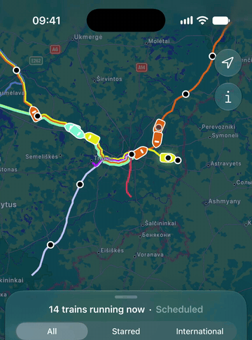
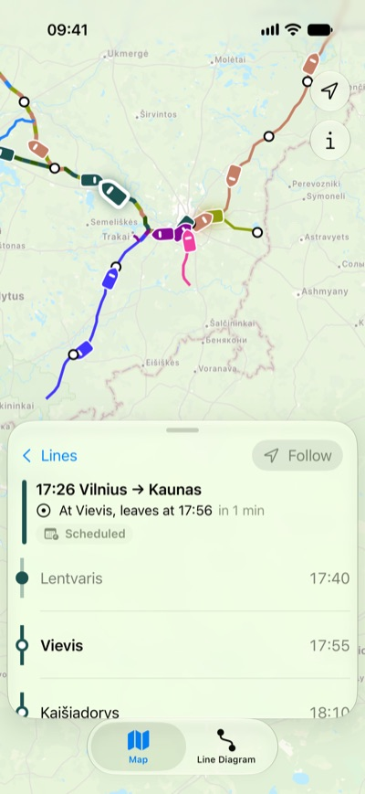
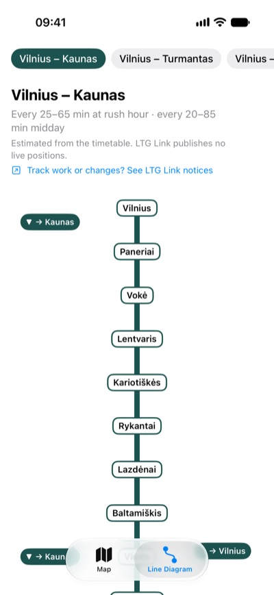
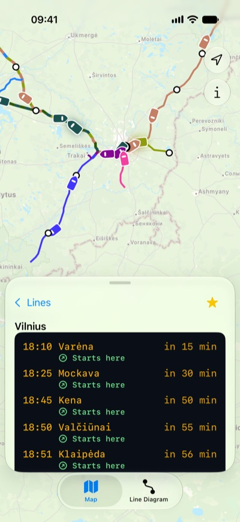
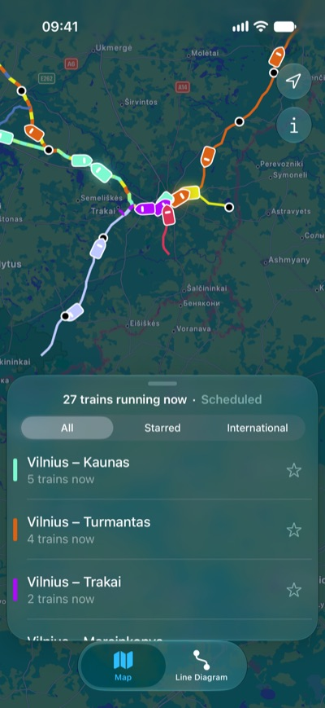

# Bėgiai

An iPhone app that shows LTG Link trains running across Lithuania. Each train's position is estimated from the published timetable, not from live GPS.

> Bėgiai is an independent project. It is not made by or affiliated with LTG or LTG Link.

Bėgiai is in beta on TestFlight. It is not on the App Store yet.

<p align="center">
  
</p>

<p align="center">
  
  
  
  
</p>

## What it does

- Draws every line on a muted Apple map and moves each running train along its track. Where lines share a track, each line gets its own stripe, side by side.
- Lists the lines in a panel over the map. Star the lines and stations you use, and they come first. Stars stay on your iPhone.
- Opens a page for each train, with its stops and its next station. A train that stands at a station links to that station.
- Shows a station's next departures on an LED-style board, with the minutes to go within the hour.
- The Line Diagram tab shows one line from end to end, with each train between two stations and how often trains run.
- At night, when no train runs, it names the first train of the morning.
- Centres the map on you. It asks for your location only after you tap the button.
- Supports VoiceOver, large text and Reduce Motion, with settings for larger train markers and high contrast.
- Gets a fresh timetable each day and says when the timetable it has is getting old.
- Has an optional tip jar in About. A tip unlocks nothing.

## Requirements

- Xcode 26 and iOS 26 or later
- Swift 6.2

## Build and run

Open `Begiai.xcodeproj`, pick the `Begiai` scheme and an iPhone simulator, and run.

The timetable ships with the app as `Begiai/timetable.json`. To rebuild it from the latest GTFS feed:

```sh
script/bundle.sh               # downloads the feed, then writes Begiai/timetable.json
script/bundle.sh --no-download # reuses the feed already downloaded
```

A GitHub Actions workflow (`.github/workflows/timetable.yml`) runs this each morning and publishes the timetable, with the support and privacy pages, to [GitHub Pages](https://yukisekimi.github.io/Begiai/). The app downloads it from there.

The `begiai-bundle` tool keeps LTG Link trips only, drops duplicate trips, flags sections that would be impossibly fast, places each stop along its track and simplifies the track shapes.

## Layout

| Path | What |
| --- | --- |
| `Begiai/` | The app: views, scenes and launch. Text lives in `Localizable.xcstrings`. |
| `BegiaiKit/` | The logic as a Swift package: models, stores, the motion engine and the `begiai-bundle` tool. |
| `BegiaiUITests/` | UI journeys, driven through screen helpers in `Support/Screens/`. |
| `Begiai/A11yID.swift` | The accessibility identifier registry. `A11yID.md` is generated from it. |
| `TestPlans/` | The test plan and `areas.json`, which maps each area to its unit targets and journeys. |
| `Fixtures/` | The frozen timetable of 17 Nov 2026 that the journeys use. |
| `Pages/` | The support and privacy pages on GitHub Pages. |
| `Store/` | The App Store listing and the screenshot slides, with how to remake them. |
| `docs/` | The README's GIF and pictures. |
| `script/` | `test.sh` for tests, `bundle.sh` for the timetable and `readme-gif.sh` for the map GIF. |

## Tests

`script/test.sh <lane>` is the only way to run tests. Each lane prints `GREEN`, or `RED` with each failure and a `rerun:` line.

| Lane | What |
| --- | --- |
| `unit [--area <id>]` | `swift test` in BegiaiKit, headless (about 1 s) |
| `journey [<Journey>/<test>] [--no-build]` | UI journeys on the simulator whose UDID is in `$BEGIAI_SIM` |
| `build` | Release build, unsigned. It fails if the Release app allows a sealed launch. |
| `a11y [--check]` | Writes or checks `A11yID.md` |
| `check` | a11y check, unit and build. Run it before each commit. |
| `all` | `check`, then `journey` |

UI journeys use a sealed launch (`--sealed --reset --now <ISO time>`) that pins the clock and keeps stars in a temporary folder. It works only in Debug builds. With `--speed <n>`, the clock starts at `--now` and runs n times faster, which `script/readme-gif.sh` uses to record the map.

## Data

The timetable comes from the national GTFS feed at [visimarsrutai.lt](https://www.visimarsrutai.lt/gtfs/). Train positions are interpolated from the timetable, so they show where a train should be, not where it is. Delays and cancellations are not shown.

Privacy policy: [yukisekimi.github.io/Begiai/privacy.html](https://yukisekimi.github.io/Begiai/privacy.html). The app has no account, no ads and no tracking.
